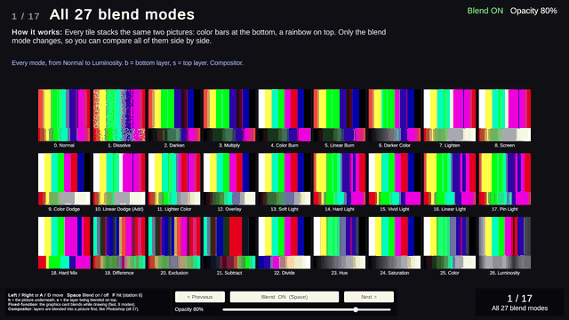
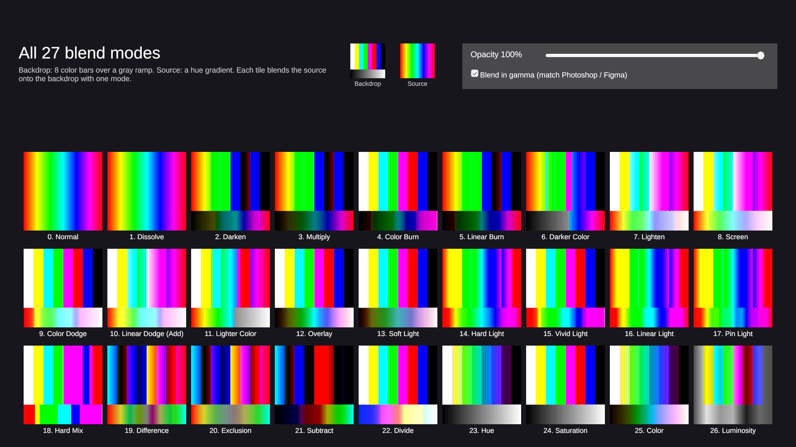
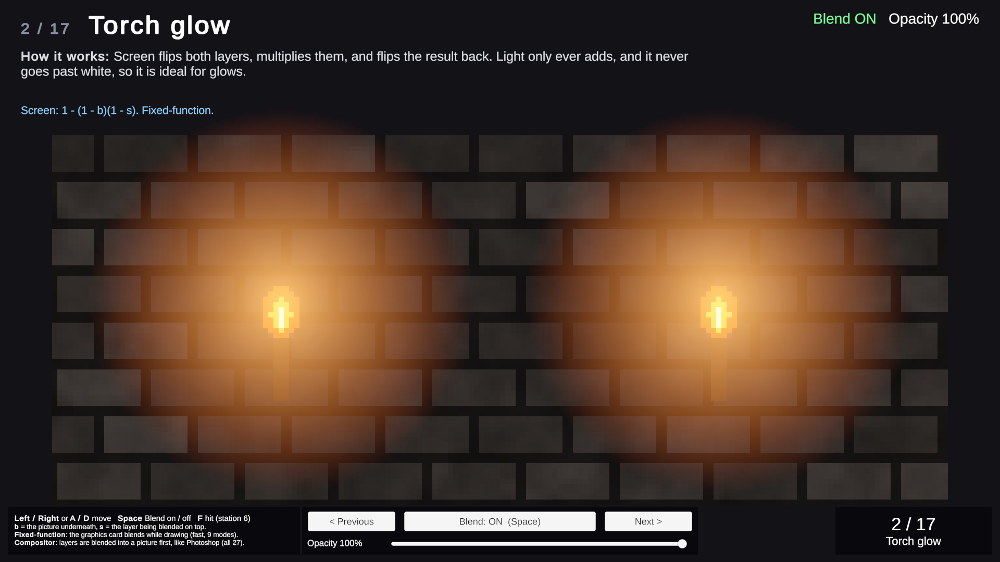
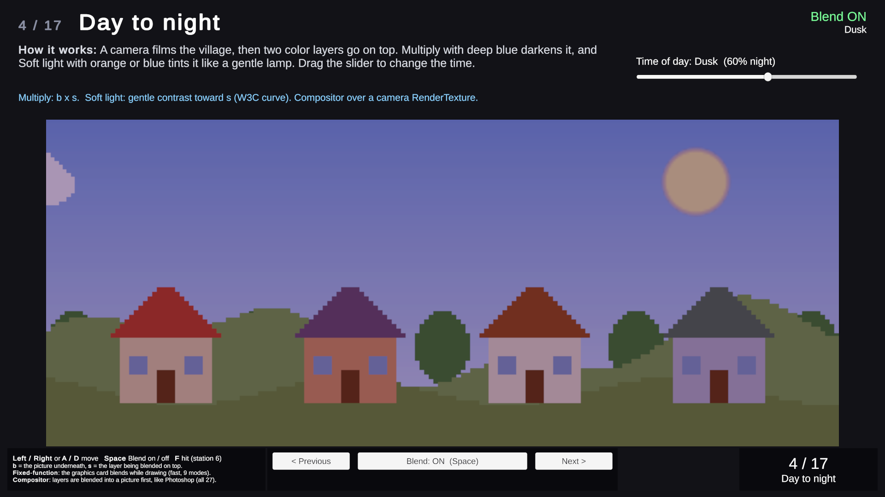
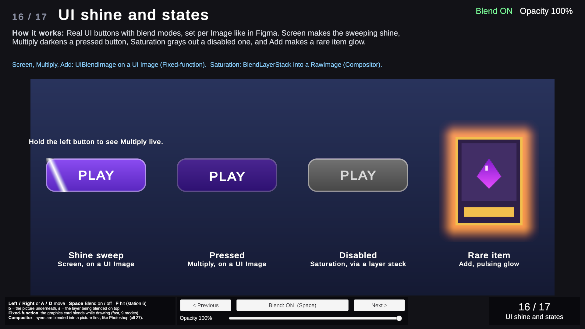
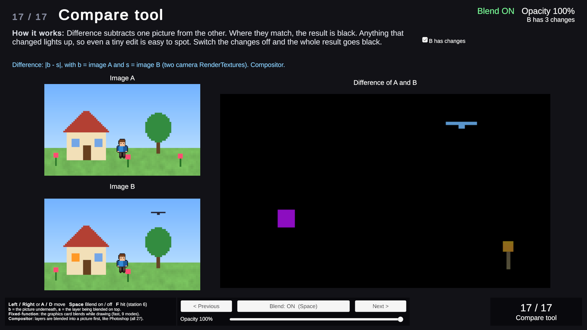
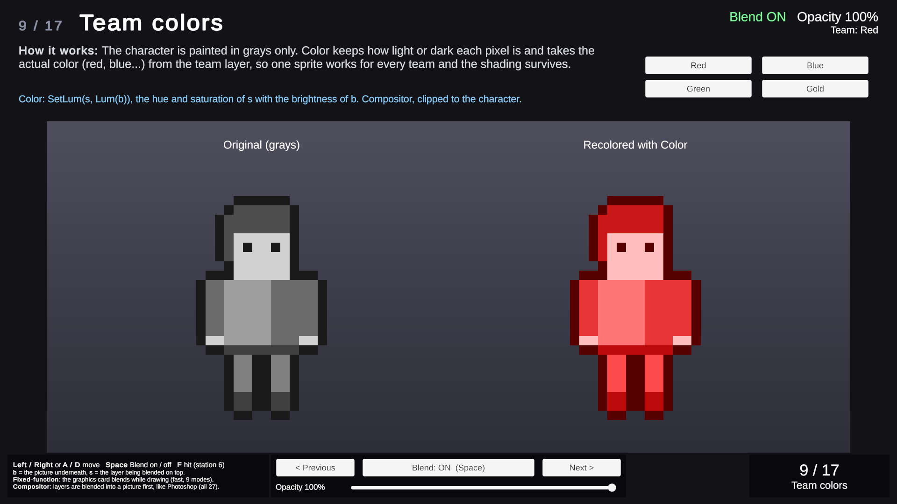
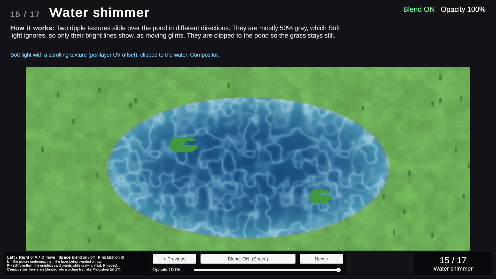

# Unity Blend Modes

All 27 Photoshop-style layer blend modes for Unity UI and 2D, running on the Built-in Render Pipeline in Linear color space and matching design tools within 2/255.



## Overview

Unity's GPU blender handles a handful of blend equations, but artists think in Photoshop and Figma layer modes: Overlay, Soft Light, Color, Hue and the rest. This project brings the full set to Unity in two forms: a **fixed-function** path for the 9 modes the GPU can do in a single pass, which is cheap enough for sprites, particles and UI, and a **compositor** that flattens texture layers with any of the 27 modes, like a layer group. A gallery, a 17-station showcase of real game use cases, and an edit-mode test suite that checks every mode against an independent reference come with it.

## Supported modes

Grouped like the Photoshop layer panel. **Bold** modes also run on the fixed-function path (`FixedBlend`, `UIBlendImage`); all 27 run in the compositor (`BlendLayerStack`).

| Group | Modes |
|---|---|
| Normal | **Normal**, Dissolve |
| Darken | **Darken**, **Multiply**, Color Burn, **Linear Burn**, Darker Color |
| Lighten | **Lighten**, **Screen**, Color Dodge, **Linear Dodge (Add)**, Lighter Color |
| Contrast | Overlay, Soft Light, Hard Light, Vivid Light, Linear Light, Pin Light, Hard Mix |
| Inversion | Difference, **Exclusion**, **Subtract**, Divide |
| Component | Hue, Saturation, Color, Luminosity |

Formulas for every mode are in [Blend-Formulas-Reference.md](Assets/BlendModes/Documentation/Blend-Formulas-Reference.md).

## Features

- **27 blend modes** following the W3C *Compositing and Blending Level 1* spec (separable, whole-pixel and non-separable modes)
- **Fixed-function path** for 9 modes: one material, zero extra passes, works on sprites, particles and tilemaps
- **`UIBlendImage`**: gives a uGUI `Image`, `RawImage` or `Text` a blend mode; works inside `Mask` and `RectMask2D` and with sprite atlases
- **`BlendLayerStack`**: a layer stack with per-layer mode, opacity, visibility, clipping mask and UV tiling/offset, rendered to a `RenderTexture`
- **Gamma-correct blending in a Linear project**, using the exact sRGB curve, so results match Photoshop and Figma
- **Gallery scene** showing all 27 modes side by side, with live opacity and a gamma toggle
- **17-station showcase** of practical game uses: torch glow, shadows, day/night, particles, hit flash, dissolve, glitch, team colors, status effects, desaturate on damage, texture detail, tilemap variation, haze, water, UI states and an image compare tool
- **93 edit-mode tests**, including a GPU-vs-reference check of every deterministic mode over a 12 x 12 color grid
- **Showcase audit tool** that captures every station with blending on and off and runs a station-specific pixel check

## How it works

### Two ways to blend

**Fixed-function** (`FixedBlend.cs`, `FixedBlend.shader`, `UIFixedBlend.shader`). Nine modes map directly onto GPU blend state, so the GPU blends the object with what is already on screen. For example Multiply is `Blend DstColor Zero`, Screen is `Blend OneMinusDstColor One`, Darken/Lighten use `BlendOp Min/Max`, and Subtract uses `BlendOp RevSub`. `FixedBlend.Apply(material, mode)` sets the source/destination factors and op as material properties, so one shader covers all 9. The GPU blender has no opacity input for these modes, so the shader fades its *output* toward the mode's neutral color (white for Multiply, black for Screen and Add). That is exact for 7 of the 9 modes and a close approximation for Darken and Lighten.

**Compositor** (`BlendLayerStack.cs`, `BlendCompositor.shader`, `BlendFunctions.cginc`). Modes like Overlay, Soft Light or Hue need to read the backdrop, which fixed-function blending cannot do. The stack ping-pongs between two `RenderTexture`s: each layer is one `Graphics.Blit` that reads the backdrop as `_MainTex`, blends the layer's texture with the selected mode, and composites with straight alpha using the W3C formula. The last layer writes straight into `Result`, so N layers cost N blits plus one clear. The stack only re-composites when something changes, unless `continuous` is on. To blend over the scene itself, render a camera into a `RenderTexture` and use it as the bottom layer; stations 4, 8, 13, 14 and 17 do this.

The mode is a uniform branch (`[branch] switch` on `_Mode`), not 27 shader variants. The branch is coherent across the draw, so it costs close to nothing and keeps build size and warm-up small. Every divide is guarded, and Dissolve uses a sine-free hash seeded by the integer pixel position, so its pattern is stable on every GPU.

### Linear vs sRGB

The project runs in **Linear** color space. Design tools blend gamma-encoded values, so blending linear values directly would not match Photoshop. With `blendInGamma` on (the default), the compositor converts backdrop and source to sRGB before blending and converts the result back to linear. It uses the exact piecewise sRGB transfer function (`BlendLinearToSRGB` / `BlendSRGBToLinear`), not UnityCG's fast approximations, which drift by several 8-bit steps in dark tones. Textures and render targets use standard sRGB formats, so the hardware handles decode and encode on read and write. In a Gamma project the conversion compiles out.

Fixed-function blends happen in the GPU blender, in the render target's space. In Linear they blend linear values. This is the expected trade-off for the cheap path.

### `UIBlendImage`

An `IMaterialModifier` on any uGUI `Graphic`. It clones the graphic's material with the `UIFixedBlend` shader, applies the mode's blend state and opacity, and copies the stencil properties that `Mask` and `RectMask2D` set, so masking keeps working. It offers the 9 fixed-function modes. For any other mode on UI, build the look in a `BlendLayerStack` and show its `Result` in a `RawImage`; the Disabled button in station 16 works this way.

### Layer stack

Each `BlendLayer` has a texture, mode, opacity, visibility, `clipToBackdrop` (Photoshop clipping mask: the layer only shows where the layers below are opaque), and UV tiling/offset for scrolling textures such as the water ripples in station 15. The stack's `resolution`, `filterMode` (Point keeps pixel art crisp and avoids dark fringes) and `blendInGamma` are set per stack.

### Gallery and showcase

- `BlendModeGallery.unity` blends one hue gradient over color bars and a gray ramp with every mode, with an opacity slider and a gamma toggle.
- `BlendShowcase2D.unity` is a guided tour of 17 stations. Left/Right moves between them, Space turns blending off so you see the same layers with plain Normal blending, and the slider sets opacity. All art is generated in code (`ProcArt.cs`). The scene is rebuilt from `StationDefs.cs` with `Tools > Blend Mode > Build Showcase Scene`. See the [Showcase Guide](Assets/BlendModes/Documentation/Showcase-Guide.md) and the [Designer Cheat Sheet](Assets/BlendModes/Documentation/Designer-CheatSheet.md).
- `BlendTest.unity` is a minimal test scene.

### Tests

`Tests/Editor` (assembly `BlendMode.Tests.Editor`), run from **Window > General > Test Runner > EditMode**:

| Suite | What it checks |
|---|---|
| `BlendReferenceTests` | Every deterministic mode on the GPU against `BlendReference.cs`, an independent C# implementation of the W3C formulas, over a 12 x 12 grid of grays, primaries, secondaries and mixed colors. Tolerance 2/255. |
| `BlendCompositorTests` | Gray-value spot checks per mode, Color on gray, opacity midpoint, Difference of a texture with itself, Dissolve pixel ratio, clipping mask, UV offset, fixed-function setup for exactly 9 modes |
| `BlendLayerStackRobustnessTests` | No layers, null textures and layers, hidden layers, single-layer copy, opacity clamping, long ping-pong chains, resolution changes, disable/enable, missing shader fallback |
| `UIBlendImageTests` | GPU blend setup, opacity, backdrop-only modes falling back to Normal with a warning, stencil kept from a parent Mask, disabled component |

### Key scripts

| File | Role |
|---|---|
| `Scripts/Runtime/LayerBlendMode.cs` | The 27 modes, in shader index order |
| `Scripts/Runtime/BlendLayerStack.cs` | Layer stack compositor |
| `Scripts/Runtime/FixedBlend.cs` | Fixed-function blend state for 9 modes |
| `Scripts/Runtime/UIBlendImage.cs` | Blend modes on uGUI graphics |
| `Shaders/BlendFunctions.cginc` | All blend math, sRGB transfer functions |
| `Shaders/BlendCompositor.shader` | One compositing pass: blend + W3C alpha compositing |
| `Shaders/FixedBlend.shader`, `UIFixedBlend.shader` | Fixed-function blending for sprites and UI |
| `Scripts/Gallery/BlendGallery.cs` | Gallery behavior |
| `Showcase/Runtime/Station.cs`, `ShowcaseController.cs` | Showcase base class and navigation |
| `Showcase/Tests/Editor/ShowcaseAudit.cs` | Captures and checks every station |

Assemblies: `BlendMode` (runtime), `BlendMode.Gallery`, `BlendMode.Editor`, `BlendMode.Showcase`, `BlendMode.Showcase.Editor`, `BlendMode.Showcase.Audit`, `BlendMode.Tests.Editor`.

## Test and audit results

Measured in Unity 6000.5.1f1, Linear color space, Direct3D 12, AMD Ryzen 9 7900X / RTX 4070 Ti SUPER.

- **Edit-mode tests:** 93 / 93 passed.
- **Showcase audit** (`Tools > Blend Mode > Run Showcase Audit`, in Play mode): 17 / 17 station checks passed, 0 console warnings or errors. Average frame time per station in the Editor: 0.8 to 1.1 ms.

## Performance notes

- The fixed-function path adds no passes: it is a regular draw with a different blend state.
- In the compositor, the cost that matters is bandwidth. Each layer is one full-target read, one layer-texture read and one write. Keep `continuous` off for static stacks, size `resolution` to the display size, and prefer the fixed-function path whenever the mode is one of the 9.
- Intermediate targets are 8-bit (`ARGB32`), so each layer quantizes the backdrop by at most about 1/255. Use `ARGBHalf` for very deep stacks or HDR inputs.

## Screenshots

| | |
|---|---|
|  |  |
|  |  |
|  |  |
|  | |

## Getting started

- **Unity:** 6000.5.1f1 (Unity 6.5)
- **Render pipeline:** Built-in Render Pipeline
- **Color space:** Linear
- **Open:** add the repository folder in Unity Hub and open it with 6000.5.1f1.
- **Scenes:** `Assets/BlendModes/Scenes/BlendModeGallery.unity` (all modes) and `Assets/BlendModes/Scenes/BlendShowcase2D.unity` (17 stations). Press Play.

**Showcase controls**

| Input | Action |
|---|---|
| Left / Right or A / D | Previous / next station |
| Space | Blend on / off |
| HUD slider | Opacity of the blended layer |
| F | Trigger the hit flash (station 6) |

**Use it in your own scene**

```csharp
// Sprite or particle, one of the 9 fixed-function modes
var mat = new Material(Shader.Find("Blend Mode/FixedBlend"));
FixedBlend.Apply(mat, LayerBlendMode.Screen);

// UI: add UIBlendImage to an Image and pick the mode in the Inspector

// Any of the 27 modes: flatten layers, show the result in a RawImage
var stack = gameObject.AddComponent<BlendLayerStack>();
stack.layers.Add(new BlendLayer { texture = baseTex });
stack.layers.Add(new BlendLayer { texture = overlayTex, mode = LayerBlendMode.Overlay, opacity = 0.8f });
rawImage.texture = stack.Result;
```

Assign the shaders on the components (or include them in *Always Included Shaders*) so builds keep them; `Shader.Find` is only a fallback.

## Project structure

```
Assets/
├── BlendModes/
│   ├── Scripts/
│   │   ├── Runtime/        LayerBlendMode, BlendLayerStack, FixedBlend, UIBlendImage
│   │   ├── Gallery/        BlendGallery, GalleryTextures
│   │   └── Editor/         GalleryBuilder, UiKit
│   ├── Shaders/            BlendCompositor, BlendFunctions.cginc, FixedBlend, UIFixedBlend
│   ├── Showcase/
│   │   ├── Runtime/        Station, ShowcaseController, ProcArt, Stations/ (17)
│   │   ├── Editor/         ShowcaseBuilder, StationDefs
│   │   └── Tests/Editor/   ShowcaseAudit
│   ├── Tests/Editor/       93 edit-mode tests
│   ├── Scenes/             BlendModeGallery, BlendShowcase2D, BlendTest
│   ├── Documentation/      Formulas reference, designer cheat sheet, showcase guide
│   └── Assets/             Sample textures
└── TextMesh Pro/           TMP essential resources
Media/
```

## Known limitations and future work

- Live UI blending supports the 9 fixed-function modes only. The other 18 need the backdrop, so on UI they go through a flattened `BlendLayerStack`.
- Darken and Lighten at partial opacity are approximate on the fixed-function path (exact in the compositor).
- Fixed-function blends run in linear space in a Linear project, so they can differ slightly from design tools. The compositor matches them.
- Photoshop's separate *Fill* and *Opacity* for the "special 8" modes are not modeled; everything behaves like Opacity.
- Built-in Render Pipeline only. A URP version would replace `Graphics.Blit` with a render-graph pass and port the shaders to HLSL/URP includes.
- Premultiplied-alpha textures get dark edges; export art with straight alpha.

## Documentation

- [Blend Formulas Reference](Assets/BlendModes/Documentation/Blend-Formulas-Reference.md): every formula, compositing math, performance notes
- [Designer Cheat Sheet](Assets/BlendModes/Documentation/Designer-CheatSheet.md): which mode to use for which effect, and how to set it up
- [Showcase Guide](Assets/BlendModes/Documentation/Showcase-Guide.md): how the showcase is built and how to add a station

## Credits

- Blend formulas follow the W3C [Compositing and Blending Level 1](https://www.w3.org/TR/compositing-1/) specification.
- Dissolve hash: Dave Hoskins, *Hash without Sine*.
- Font: Liberation Sans (TextMesh Pro essential resources).

## License

MIT, © 2026 Gokul Senthil. See [LICENSE](LICENSE).
